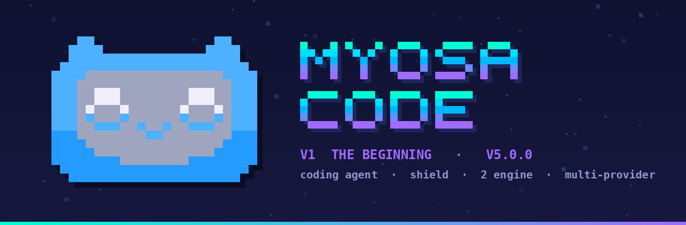

<div align="center">



<br>

**AI coding agent untuk terminal Linux, dengan pelindung VPS bawaan dan persetujuan di setiap langkah berisiko.**

*Satu file Python. Berjalan di VPS lewat SSH. Tampilan piksel.*

<br>


[Fitur](#-fitur-unggulan) · [Kenapa berbeda](#-kenapa-myosa-berbeda) · [Instalasi](#-instalasi) · [Provider](#-provider-api) · [Shield](#-myosa-shield) · [Perintah](#-perintah) · [Batasan](#-batasan-baca-ini)

</div>

---

## ✨ Fitur unggulan

| | |
|---|---|
| 🛡️ **Myosa Shield** | Pelindung VPS aktif: deteksi brute force dan port scan, blokir lewat **fail2ban + firewall (ufw)**, skor keamanan 0-100, hardening yang disetujui per langkah. |
| ✋ **Persetujuan bertingkat** | Agent boleh mengerjakan apa pun, **tapi bagian sensitif selalu berhenti** dan menunggu pilihanmu: *Lanjut sekali / Lanjut & izinkan / Lewati / Hentikan*. |
| 🧠 **Berpikir dalam** | Tiga level (`normal`, `dalam`, `ekstrem`) dengan rencana, antisipasi gagal, dan **verifikasi mandiri** sebelum menyatakan selesai. |
| 🖥️ **Tampilan ala komputer** | Pikiran mengalir real time, kode yang sedang ditulis tampil live dengan syntax highlight, dan 8 animasi berpikir. |
| 🐱 **Myosa hidup** | Maskot kucing piksel yang berkedip real time, menyapa, memberi tips saat kamu diam, dan memandu saat kamu bingung. |
| 🔌 **Multi-provider** | Satu agent, banyak penyedia API kompatibel OpenAI. API key tersimpan di `~/.myosa/.env.local`. |
| ⚙️ **Dua engine** | Engine **myosa** (API langsung) atau engine **opencode** (meneruskan ke `opencode run`). |
| 🧩 **Plugin dan `/evolve`** | Minta fitur baru, Myosa menulisnya sebagai plugin terpisah. Inti tidak tersentuh. |

---

## 🆚 Kenapa Myosa berbeda?

Banyak agent terminal sudah bisa membaca file dan menjalankan perintah. Yang membuat Myosa berbeda adalah **kombinasi** hal berikut dalam satu file yang mudah dibaca dan dimodifikasi:

1. **Agent yang menjaga servernya sendiri.** Shield bekerja bareng fail2ban dan firewall, lengkap dengan pengaman supaya kamu tidak terkunci dari VPS-mu.
2. **Persetujuan, bukan sekadar izin.** Rahasia, kirim data keluar, ubah sistem, hapus data, dan install dari internet selalu butuh keputusanmu, bahkan saat mode `AUTO`.
3. **Tahan gangguan.** Stream putus? Retry otomatis, lalu pindah ke model aktif lain. `/health` menandai model `●` aktif dan `○` mati.
4. **Aman terhadap dirinya sendiri.** Inti `myosa.py` dilindungi, ada backup otomatis, `/rollback`, `/undo`, dan penyamaran API key di output tool.
5. **Terasa hidup.** UI piksel, animasi, dan maskot yang bereaksi, bukan sekadar teks yang lewat.

> Catatan jujur: ini bukan klaim "satu-satunya di dunia". Sebagian fitur ada di agent lain. Nilai Myosa ada pada gabungannya.

---

## 🛡️ Myosa Shield

Shield berjalan di latar belakang selama Myosa terbuka dan bekerja sama dengan fail2ban dan firewall.

| Level | Perilaku |
|-------|----------|
| `pasif` | Hanya memberi peringatan, tidak memblokir apa pun. |
| `waspada` | Blokir otomatis jika skor brute force ≥ 15 per 10 menit atau scan ≥ 25 port. Menyalakan ulang fail2ban jika mati. |
| `agresif` *(bawaan)* | Blokir di skor ≥ 8 atau scan ≥ 12 port. Pelanggar berulang masuk **firewall** dengan durasi 7 kali lebih lama. fail2ban dan ufw dinyalakan ulang otomatis jika mati. |

**Yang dipantau:** brute force SSH, port scan, login berhasil setelah banyak gagal, akun UID 0 asing, port baru terbuka, dan perubahan `sshd_config`, `cron`, `sudoers`, `authorized_keys`.

**Pengaman supaya kamu tidak terkunci:**
- IP whitelist, **semua koneksi SSH yang sedang aktif**, IP server sendiri, dan jaringan privat **tidak pernah diblokir**.
- Blokir otomatis dibatasi 40 per jam dan kedaluwarsa otomatis.
- Yang diblokir adalah **IP tunggal**, bukan seluruh ASN atau rentang besar.

```text
/shield            menu Shield
/shield status     skor keamanan dan kondisi pertahanan
/shield harden     perkuat VPS (kamu setujui tiap langkah)
/shield level      pilih pasif / waspada / agresif
/shield allow      whitelist IP (anti-terkunci)
/shield bans       IP yang sedang diblokir
/shield ban IP     blokir manual   (/shield unban IP untuk membuka)
```

**Urutan aktivasi yang disarankan:**

```bash
tmux new -s myosa
myosa
/shield allow      # daftarkan IP-mu dulu
/shield harden     # fail2ban agresif, log firewall, ufw limit
/shield level      # pilih level respons
```

---

## 🚀 Instalasi

Butuh Python 3.10+ (Ubuntu/Debian).

```bash
apt install -y python3-venv git
python3 -m venv ~/myosa-env
~/myosa-env/bin/pip install -U openai rich pillow

git clone https://github.com/reinhald90/Myosa-Agent.git
cd Myosa-Agent
echo "alias myosa='~/myosa-env/bin/python ~/Myosa-Agent/myosa.py'" >> ~/.bashrc
source ~/.bashrc
```

Jalankan di **tmux** supaya sesi dan watcher Shield tidak mati saat koneksi putus:

```bash
tmux new -s myosa
myosa
```

Periksa kondisi semua komponen kapan saja dengan `/doctor`.

---

## 🔌 Provider API

Myosa bisa memakai penyedia API apa pun yang kompatibel dengan OpenAI. Key tiap provider disimpan di satu file:

```bash
nano ~/.myosa/.env.local
chmod 600 ~/.myosa/.env.local
```

```ini
# ~/.myosa/.env.local  (RAHASIA, jangan pernah di-commit)
ZYVOR_API_KEY=isi_key_lengkap
APINEX_API_KEY=isi_key_lengkap
```

Nama variabel dibuat dari nama provider: `nama` menjadi `NAMA_API_KEY`.

```text
/provider            pilih / tambah / hapus provider (menu panah)
/provider add apinex tambah provider (preset APInex tersedia)
/provider use NAMA   beralih provider
/env                 lihat status key (disamarkan)
/env reload          muat ulang setelah mengedit .env.local
```

- Key yang berisi karakter tidak valid (misalnya `…` dari key yang terpotong) otomatis ditolak dengan pesan yang jelas.
- Status model dan model terakhir disimpan **terpisah per provider**.
- Provider lain yang kompatibel OpenAI bisa ditambahkan dengan `/provider add NAMA URL`.

---

## ⌨️ Perintah

| Perintah | Fungsi |
|----------|--------|
| `/help` | Daftar perintah |
| `/model` | Pilih model (menu panah, status aktif/mati) |
| `/health [kata]` | Cek model mana yang hidup |
| `/provider` | Kelola penyedia API |
| `/engine` | Pilih engine: myosa / opencode |
| `/mode` | `dev`, `ops`, `cyber` |
| `/deep` | Kedalaman berpikir: normal / dalam / ekstrem |
| `/shield` | Pelindung VPS |
| `/audit [host]` | Audit keamanan read-only, lalu laporan oleh agent |
| `/guard on\|off\|reset` | Pengaman bagian sensitif |
| `/evolve <fitur>` | Minta Myosa membuat plugin baru |
| `/plugin` | Kelola plugin |
| `/doctor` | Periksa semua komponen |
| `/rollback`, `/undo` | Pulihkan inti Myosa / batalkan edit file terakhir |
| `/anim`, `/logo`, `/hidup` | Animasi berpikir, animasi logo, mode Myosa hidup |
| `/host` | Kelola server SSH terdaftar |
| `/key`, `/auto`, `/think`, `/save`, `/load`, `/clear`, `/exit` | Utilitas |
| `!perintah` | Jalankan shell langsung |
| `/sh` | Shell interaktif penuh |
| `@file.png` | Lampirkan gambar atau file di pesan |

---

## 🧭 Mode

- **dev**: coding dan manajemen file.
- **ops**: administrasi server (instalasi, konfigurasi, monitoring).
- **cyber**: audit dan hardening **defensif** untuk server milik sendiri. Tidak ada exploit, brute force, atau pemindaian target pihak lain.

---

## ⚠️ Batasan (baca ini)

- **Guard bukan sandbox.** Deteksi bagian sensitif berbasis pola teks. Perintah yang disamarkan bisa lolos. Awasi sendiri di server penting.
- **Shield hanya aktif selama Myosa terbuka.** Perlindungan yang tetap hidup saat Myosa ditutup datang dari fail2ban dan ufw hasil `/shield harden`.
- Langkah **SSH key-only** bisa mengunci kamu di luar VPS. Uji login dengan key di sesi kedua sebelum menyetujui.
- Deteksi port scan butuh langkah **"Catat log firewall"** dari `/shield harden`.
- `.env.local` adalah **teks biasa** yang dilindungi izin file, bukan enkripsi.
- Model kecil (mis. varian `flash`) kadang kurang rapi memanggil tool.
- Dirancang untuk Ubuntu/Debian. Belum diuji luas di distro lain.

---

## 📁 Berkas konfigurasi

```text
~/.myosa/.env.local    API key tiap provider (izin 600)
~/.myosa/config.json   pengaturan (tanpa key)
~/.myosa/hosts.json    server SSH terdaftar
~/.myosa/plugins/      plugin buatanmu / hasil /evolve
~/.myosa/backup/       cadangan inti myosa.py
~/.myosa/bans.json     IP yang diblokir Shield
~/.myosa/shield.log    log peringatan Shield
```

**Jangan pernah meng-commit folder `~/.myosa/` atau file `.env*`.**

---

## 📚 Dokumen lain

- [`Agent.md`](Agent.md): identitas, kemampuan, dan cara kerja agent.
- [`Rules.md`](Rules.md): aturan wajib untuk agent, pengguna, dan kontributor.

---

<div align="center">


**MYOSACODE AGENT** · dibuat oleh [reinhald90](https://github.com/reinhald90) (Azure Tech)

Lisensi [MIT](LICENSE)

</div>
